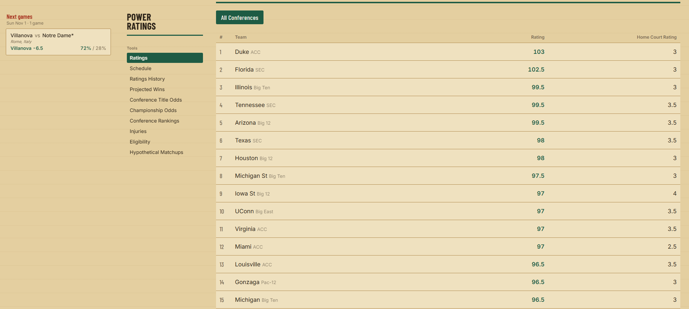
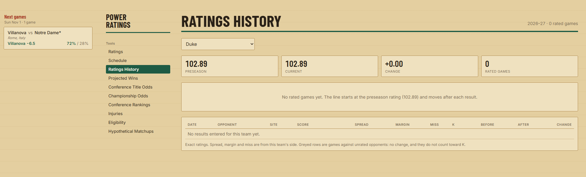

# CBK Power Ratings

Power ratings for all 365 Division I men's college basketball teams, 2026-27 season.

**Live site: https://connorriepma.github.io/CBK-Power-Ratings/**

Every rating is a point-spread number: the difference between two teams' ratings, plus home court, is the predicted margin. Each team starts the season with a preseason rating built in the offseason, and the model updates both teams' ratings after every game based on how the result compared to the predicted margin.



## How it works

The full write-up is in [METHODOLOGY.md](METHODOLOGY.md). In short:

- **Preseason rating:** last season's KenPom rating, shrunk toward the conference mean, plus a manual roster adjustment for transfers, departures and recruiting.
- **In-season updates:** after each game, both teams move by a fraction (K) of the gap between the actual and predicted margin. K is larger early in the season, when ratings are least certain.
- **Known limitations:** documented in the methodology, including the fact that the model has not been backtested yet.



## Data

[`data/preseason_ratings_2026-27.csv`](data/preseason_ratings_2026-27.csv) holds the preseason ratings for all 365 teams. The rest of the site's data (teams, schedule, injuries, eligibility) is in the other JSON files in [`data/`](data/).

| Column | Meaning |
|---|---|
| `team` | Team name |
| `manual_adjustment` | Manual roster adjustment from the original preseason build, applied on top of the KenPom-based baseline |
| `rating` | Preseason rating on a KenPom-style scale (0 = average Division I team) |
| `rating_plus_80` | `rating + 80`, the scale shown on the site so no team displays a negative value |
| `rating_plus_80_rounded` | `rating_plus_80` rounded to the nearest 0.5 |
| `notes` | Flags ratings that were manually moved after the preseason build when major news broke |

## Running it

The rating engine is [`src/cbk_ratings.py`](src/cbk_ratings.py). It uses only the Python standard library.

```
python src/cbk_ratings.py              # replay results.json onto the preseason ratings, write data/current_ratings.json
python -m unittest discover -s tests   # run the tests
```

Current ratings are never stored. They are recomputed from the preseason ratings plus every game in `data/results.json`, so the output is always consistent with the results. The tests check the worked example in the methodology, the K tiers, the miss caps, neutral sites, skipped non-Division I games and input-order independence.

## Status

Preseason ratings are set. In-season rating updates begin when games start.

## Author

Connor Riepma
